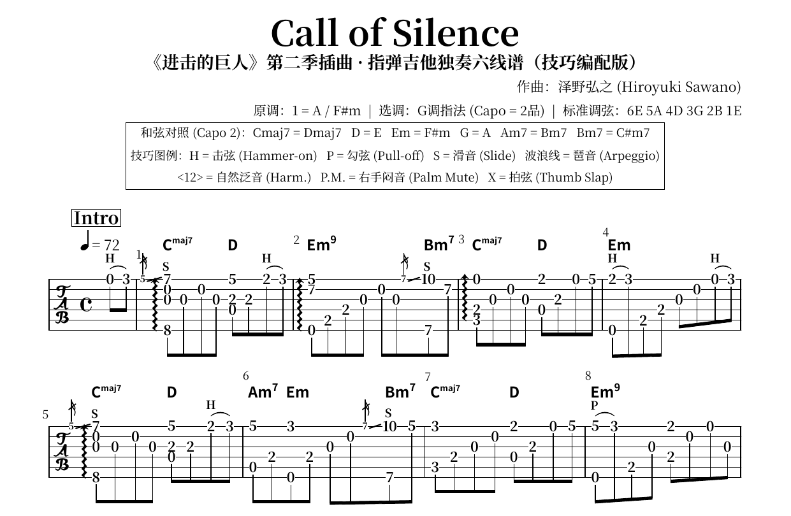

<div align="center">

# Guitar TAB Player

极简指弹吉他六线谱在线练习播放器，支持连续看谱、逐拍高亮、精细变速与本地产物包导入。

[在线使用](https://zxsos.github.io/guitar-tab-player/) · [配套编配 Skill](https://github.com/zxsos/fingerstyle-guitar-tab-skill)

<a href="https://zxsos.github.io/guitar-tab-player/"></a>

</div>

## 特性

- **连续无分页看谱 + 逐拍染色** — 按时间轴自动聚焦当前乐句并滚动，点击任意小节即可跳转播放
- **0.25×–1.5× 滑块精细变速** — 支持拖动滑块以 `0.05×` 步进调节与 8 档快捷预设，方便慢速扒谱练琴
- **ZIP 一键导入与实时校验** — 打开「导入」窗口或直接拖入 `.zip` 产物包、文件夹，自动逐项校验音频、谱面与时间清单
- **纯前端本地运行零上传** — 所有解包、图像识谱与音频解码均在浏览器本地完成

## ZIP 产物包结构

```text
*_bundle.zip
├── sync_manifest.json        # 同步时间轴与切片坐标（缺失时自动识谱并支持校准）
├── *.mp3                     # 试听音频（支持 mp3 / wav / m4a / ogg）
├── previews/
│   └── page-*.png            # 高清谱面预览图
└── *.pdf                     # 原版矢量六线谱（可选）
```

可通过配套的 [fingerstyle-guitar-tab-skill](https://github.com/zxsos/fingerstyle-guitar-tab-skill) 一键编配并打包生成新曲目的 `*_bundle.zip`。

## License

[MIT](LICENSE)
